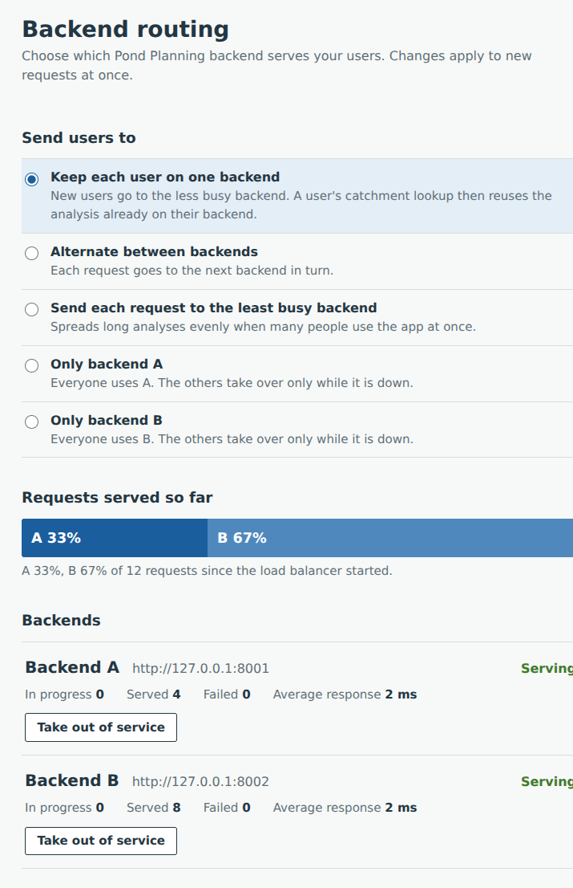

# Load balancer for the Pond Planning API

A small load balancer that runs in front of two copies of the Pond Planning
backend and sends each user to one of them. While it runs you can switch
where users go: spread them across both backends, or send everyone to
backend A or to backend B. You switch from a control page in the browser or
with a single command. If a backend stops answering, its users move to the
other one automatically.

```
browser ──▶ frontend :5173 (/api) ──▶ load balancer :8000 ──┬──▶ backend A :8001
                                                            └──▶ backend B :8002
```

Neither the frontend nor the backend needs code changes. The frontend already
sends its requests to port 8000, which is now the load balancer, and the
backends run unchanged on ports 8001 and 8002.

## Contents

- [Requirements](#requirements)
- [Quick start](#quick-start)
- [Telling the load balancer where the backends are](#telling-the-load-balancer-where-the-backends-are)
- [Telling the frontend where the load balancer is](#telling-the-frontend-where-the-load-balancer-is)
- [Switching backends](#switching-backends)
- [Seeing it switch](#seeing-it-switch)
- [Health checks](#health-checks)
- [Settings](#settings)
- [Who can switch backends](#who-can-switch-backends)
- [How requests are handled](#how-requests-are-handled)
- [Telemetry (OpenTelemetry)](#telemetry-opentelemetry)
- [Troubleshooting](#troubleshooting)
- [Tested](#tested)
- [Limits](#limits)
- [Files](#files)

## Requirements

- Python 3.12 (tested with 3.12.3)
- The packages in `requirements.txt`: Starlette, httpx, Uvicorn and OpenTelemetry
- The `backend` and `pond-frontend` folders, unzipped next to this one

## Quick start

**Install once**, from the folder that holds `backend`, `load-balancer` and
`pond-frontend`:

```bash
cd backend
pip install -r requirements.txt
cd ../load-balancer
pip install -r requirements.txt
cd ../pond-frontend
npm install
```

**Every time**, open four terminals and start one thing in each, in this
order. Leave them all running.

| Terminal | Folder | Command |
| --- | --- | --- |
| 1: backend A | `backend` | `uvicorn app.main:app --host 127.0.0.1 --port 8001 --workers 2` |
| 2: backend B | `backend` | `uvicorn app.main:app --host 127.0.0.1 --port 8002 --workers 2` |
| 3: load balancer | `load-balancer` | `uvicorn balancer:app --host 127.0.0.1 --port 8000` |
| 4: frontend | `pond-frontend` | `npm run dev` |

The commands are the same on Windows, macOS and Linux. If `uvicorn` isn't
found, write `python -m uvicorn` instead.

Then open:

- the app: **http://localhost:5173**
- the control page: **http://127.0.0.1:8000/lb/**

Within a few seconds both backends show **Serving** on the control page. To
stop, press Ctrl+C in each terminal.

Run the load balancer as **one process**: don't add `--workers` to its
command, because its routing settings are kept in memory. One process
handles many users at once, since it only forwards requests.

## Telling the load balancer where the backends are

The load balancer reads the backends' addresses from the environment
variable `LB_BACKENDS`: a comma-separated list of `name=url` pairs. The
default is:

```
a=http://127.0.0.1:8001,b=http://127.0.0.1:8002
```

That's why the quick start works without setting anything. Set
`LB_BACKENDS` only when the backends run elsewhere. Set it in the terminal
where you start the load balancer, before the `uvicorn` command:

macOS / Linux:

```bash
LB_BACKENDS="a=http://127.0.0.1:9001,b=http://127.0.0.1:9002" uvicorn balancer:app --host 127.0.0.1 --port 8000
```

Windows PowerShell:

```powershell
$env:LB_BACKENDS="a=http://127.0.0.1:9001,b=http://127.0.0.1:9002"
uvicorn balancer:app --host 127.0.0.1 --port 8000
```

Windows Command Prompt:

```bat
set LB_BACKENDS=a=http://127.0.0.1:9001,b=http://127.0.0.1:9002
uvicorn balancer:app --host 127.0.0.1 --port 8000
```

Each terminal writes environment variables differently; see
[Settings](#settings) for when a `$` is needed.

**Backends on other computers.** Start each backend with `--host 0.0.0.0`
so it accepts connections from the network, allow its port through that
computer's firewall, and list the network addresses:

```bash
uvicorn app.main:app --host 0.0.0.0 --port 8001 --workers 2    # on each backend computer
```

```
LB_BACKENDS="a=http://192.168.1.20:8001,b=http://192.168.1.21:8001"
```

**Rules for the list**

- Each URL starts with `http://` or `https://` and has nothing after the
  port.
- Names are optional: `http://10.0.0.5:8001,http://10.0.0.6:8001` names them
  `a` and `b`.
- Names must differ, and can't be `sticky`, `round_robin` or
  `least_connections`, which are routing modes.
- More than two backends work too. Each gets a row and an "Only …" option on
  the control page.

The list is read once, at start-up. To change it, stop the load balancer,
set the new value and start it again. When it starts, it prints the list it
is using, for example `routing to a=http://127.0.0.1:8001,
b=http://127.0.0.1:8002 in mode sticky`, and the control page shows each
backend's URL.

## Telling the frontend where the load balancer is

By default you don't need to. The frontend's development server forwards
every request under `/api` to `http://127.0.0.1:8000`, which is where the
load balancer runs. The browser only ever talks to the frontend's own
address.

The address is stored in two places in `pond-frontend`:

- **`vite.config.js`, line 7: where requests are forwarded.**

  ```js
  const BACKEND_URL = process.env.BACKEND_URL ?? "http://127.0.0.1:8000";
  ```

  This is used by both `npm run dev` and `npm run preview`. Each strips the
  `/api` prefix, so `/api/analyzeContour` reaches the load balancer as
  `/analyzeContour`.
- **`src/api.js`, line 13: where the browser sends requests.** This is
  normally just `/api`, a path on the frontend's own address.

  ```js
  const API_URL = (import.meta.env.VITE_API_URL || "/api").replace(/\/+$/, "");
  ```

If the load balancer runs elsewhere, set `BACKEND_URL` before starting the
frontend. Despite its name, it should point at the **load balancer**, not at
a backend, or the load balancer is bypassed.

```bash
BACKEND_URL=http://192.168.1.20:8000 npm run dev            # macOS / Linux
```

```powershell
$env:BACKEND_URL="http://192.168.1.20:8000"; npm run dev    # Windows PowerShell
```

```bat
rem Windows Command Prompt
set BACKEND_URL=http://192.168.1.20:8000
npm run dev
```

To change the default permanently, edit line 7 of `vite.config.js`.
Restart the frontend after either change, since the file is read only at
start-up.

**Built frontend.** Keep the page and `/api` on one address. Either run
`npm run build` and then `npm run preview`, which forwards the same way, or
serve `dist/` with a web server that forwards `/api/` to the load balancer.
For example, with nginx:

```nginx
location /api/ {
    proxy_pass http://127.0.0.1:8000/;   # the trailing / removes /api
    client_max_body_size 110m;
    proxy_read_timeout 180s;
}
```

Don't use `VITE_API_URL` to make the browser call the load balancer's
address directly. The browser would block those requests unless CORS were
added, and the cookie that keeps each user on one backend wouldn't work
across addresses.

**Check the connection** with everything running:

- http://localhost:5173/api/ shows `{"message":"Pond Planning API is running"}`.
  The frontend reached the load balancer, and the load balancer reached a
  backend.
- http://localhost:5173/api/lb/ shows the control page through the frontend.

## Switching backends

On the control page, under **Send users to**, choose one of:

| Option | Mode name | What happens |
| --- | --- | --- |
| Keep each user on one backend | `sticky` (default) | Each user stays on one backend; new users go to the less busy one |
| Alternate between backends | `round_robin` | Requests take turns |
| Send each request to the least busy backend | `least_connections` | Each request goes where the fewest are in progress |
| Only backend A / Only backend B | `a` / `b` | Everyone goes to that backend; the other is used only while it is down |



Under **Backends**, *Take out of service* stops sending users to a backend,
for example before you restart or update it, and *Put back in service*
returns it. Changes apply to new requests at once; requests already running
finish where they are.

The same switches work from the command line:

```bash
curl http://127.0.0.1:8000/lb/status
curl -X POST http://127.0.0.1:8000/lb/mode -H "Content-Type: application/json" -d '{"mode": "b"}'
curl -X POST http://127.0.0.1:8000/lb/backends/a -H "Content-Type: application/json" -d '{"enabled": false}'
```

In Windows PowerShell, use its own command instead, which handles the
quoting the same way in every version:

```powershell
Invoke-RestMethod http://127.0.0.1:8000/lb/status
Invoke-RestMethod -Method Post -Uri http://127.0.0.1:8000/lb/mode -ContentType "application/json" -Body '{"mode": "b"}'
Invoke-RestMethod -Method Post -Uri http://127.0.0.1:8000/lb/backends/a -ContentType "application/json" -Body '{"enabled": false}'
```

`sticky` is the default because it suits this app. After a user's analysis,
the app asks for the pond's catchment with the same file. In `sticky` mode
that second request reaches the backend that has just analysed the file and
still has it cached. In testing it took 17–43 ms instead of a full rebuild
of about a second.

## Seeing it switch

In the default `sticky` mode, each user stays on the backend they first got.
If you test alone in one browser, you'll always see the same backend, which
can look as if it isn't switching. A different browser or a private window
counts as another user and may get the other backend.

To watch it switch:

- Choose **Alternate between backends** and run a few analyses in the app.
  The *Requests served so far* bar fills for both A and B.
- Or open the browser's developer tools, go to Network, and look at the
  `X-Backend` header on each request: `a` or `b`.
- Or stop one backend with Ctrl+C while using the app. The app keeps
  working, and the control page shows that backend as *Down*.

## Health checks

The load balancer polls every backend and also notices failures in real
requests.

**Polling.** Every 5 seconds it sends `GET /` to all backends at once and
waits up to 2 seconds for an HTTP 200 (`_health_loop()` and `_check()` in
`balancer.py`).

- After **2 failed checks in a row**, a backend is taken out of rotation, and
  the control page shows *Down* with the reason, such as `health check failed
  (ConnectError)`.
- After **2 passed checks in a row**, it is put back.

Requiring two in a row means one slow reply doesn't remove a backend, and one
that is still starting up isn't put back too early. Backends taken out of
service by hand are still polled, so their status stays current.

**Failed requests.** If the load balancer can't connect to a backend while
forwarding a user's request, it marks that backend down at once, without
waiting for the next poll, and sends the request to the other backend.

**Timing with the defaults**

- A dead backend is noticed on the first request that hits it. With no
  traffic, polling notices it within about 10–14 seconds.
- A restarted backend rejoins after two passed polls, about 10 seconds.

`GET /` proves that the backend process is running and answering, not that
an analysis works. A backend that answers but fails during analysis keeps
passing the check, and its errors reach users.

The terminal logs each change, for example `backend b is down` and
`backend b is back up`.

## Settings

All settings are environment variables, set in the terminal before the
load balancer starts.

| Variable | Default | Meaning |
| --- | --- | --- |
| `LB_BACKENDS` | `a=http://127.0.0.1:8001,b=http://127.0.0.1:8002` | The backends, as `name=url`, comma-separated |
| `LB_MODE` | `sticky` | Mode at start-up: `sticky`, `round_robin`, `least_connections` or a backend name |
| `LB_ADMIN_TOKEN` | not set | Token required to view the status or switch backends |
| `LB_HEALTH_INTERVAL` | `5` | Seconds between health checks |
| `LB_HEALTH_PATH` | `/` | Path polled on each backend; must answer 200 |
| `LB_TIMEOUT` | `180` | Seconds to wait for a backend's answer |
| `LB_MAX_BODY_MB` | `110` | Largest upload accepted, in MB |

The "two in a row" thresholds are the constants `FALL` and `RISE` near the
top of `balancer.py`. Telemetry uses the standard `OTEL_*` variables; see
[Telemetry](#telemetry-opentelemetry).

**Writing environment variables.** The `$` belongs to the terminal, not to
the variable's name:

| Where | Setting a variable | Reading it |
| --- | --- | --- |
| macOS / Linux (bash, zsh) | `LB_MODE=b` (no `$`) | `echo $LB_MODE` |
| Windows PowerShell | `$env:LB_MODE="b"` | `$env:LB_MODE` |
| Windows Command Prompt | `set LB_MODE=b` | `echo %LB_MODE%` |
| Python (`balancer.py`) | | `os.environ.get("LB_MODE")` |

In bash, `$LB_MODE=b` is a mistake: the shell substitutes the variable's
current value and tries to run the result as a command.

## Who can switch backends

Without `LB_ADMIN_TOKEN`, only requests from the computer the load balancer
runs on may use the control page and the `/lb/` admin API. The frontend's
development server runs on that same computer, so its users count as local.
**If other people use the app, set a token**:

```bash
LB_ADMIN_TOKEN="choose-a-long-random-value" uvicorn balancer:app --host 127.0.0.1 --port 8000
```

The control page then asks for the token and keeps it for that browser tab.
From the command line, send it as a header:
`curl -H "X-Admin-Token: choose-a-long-random-value" http://127.0.0.1:8000/lb/status`
(in PowerShell, add `-Headers @{"X-Admin-Token"="choose-a-long-random-value"}`
to `Invoke-RestMethod`).

## How requests are handled

- **Retrying.** If the load balancer can't connect to a backend, it resends
  the same request to the other backend, so users see no error. This is safe
  because the analysis endpoints change nothing on the server. If a backend
  accepts a request but doesn't answer within `LB_TIMEOUT`, the user gets a
  504 and the request is not retried, which would only double the load.
- **Sticky users.** In `sticky` mode a cookie named `lb_backend` records each
  user's backend. If that backend goes down or is taken out of service, the
  user moves to the other one and the cookie is updated.
- **Headers.** Every response carries `X-Backend` (which backend answered)
  and `X-Request-ID`, which also appears in the log. Backends receive
  `X-Forwarded-For`, `X-Forwarded-Proto` and `X-Forwarded-Host`.
- **Errors.** Backend errors (400, 404, 413, …) pass through unchanged. The
  load balancer itself answers 413 for an upload over `LB_MAX_BODY_MB`, 502
  when every backend failed, 503 when none is available, and 504 for a
  timeout.
- **Monitoring.** `GET /lb/health` answers 200 while at least one backend is
  available and 503 otherwise, for use with an uptime monitor.

## Telemetry (OpenTelemetry)

The load balancer can record **traces** and **metrics** with
OpenTelemetry, and passes the trace on to the backends. With telemetry on
in both, each user request becomes one trace: the load balancer's routing
decision, the forward to the backend, and every analysis stage inside it.
Telemetry is **off unless you turn it on**.

```
POST /analyzeContour     load balancer, server   lb.mode=sticky lb.backend=b lb.attempts=1
└─ POST                  load balancer, client   (the forward; sends the traceparent header)
   └─ POST /analyzeContour     backend, server
      └─ pond.analyze_ponds → pond.build_terrain → parse, project, sample,
                                 interpolate, fill, route, find ponds
```

### What the load balancer records

**On each request's span**

| Attribute | Meaning |
| --- | --- |
| `lb.mode` | routing mode at the time |
| `lb.backend` | backend that answered |
| `lb.attempts` | backends tried: 2 means the first failed and the request failed over |
| `lb.outcome` | `forwarded`, `timeout`, `all_failed` or `no_backend` |

Each backend that couldn't be reached adds an `lb.backend_failed` event
with the backend's name and the error. Mode changes and taking backends in
or out of service are traced too, with the old and new values, as a record
of who switched what and when. Health checks and the control page's status
polling are not traced, so they don't bury the real requests.

**Metrics**

| Metric | Meaning |
| --- | --- |
| `lb.backend.request.duration` | seconds each backend took to answer, by `lb.backend` and status code |
| `lb.failovers` | requests resent to another backend, by the backend that failed |
| `lb.requests.refused` | requests answered 503 because no backend was available |
| `lb.backend.available` | 1 while a backend is in rotation, 0 while it's down or out of service |
| `lb.backend.requests.in_progress` | requests each backend is working on now |
| `http.server.duration`, `http.client.duration`, … | standard HTTP metrics |

**Finding a request's trace.** With telemetry on, every response carries
`X-Trace-ID`, and the log line for the request ends with `trace <id>`. In
the browser, open the developer tools, go to Network, pick a request and
copy `x-trace-id` from its response headers. Paste it into the trace
viewer's search.

### Turning it on

Use the same environment variables as the backend, set before `uvicorn`:

```bash
# macOS / Linux
OTEL_EXPORTER_OTLP_ENDPOINT=http://localhost:4318 uvicorn balancer:app --host 127.0.0.1 --port 8000
```

```powershell
# Windows PowerShell
$env:OTEL_EXPORTER_OTLP_ENDPOINT="http://localhost:4318"
uvicorn balancer:app --host 127.0.0.1 --port 8000
```

| Variable | Effect |
| --- | --- |
| `OTEL_EXPORTER_OTLP_ENDPOINT` | where to send traces and metrics (OTLP over HTTP, usually port 4318) |
| `OTEL_TRACES_EXPORTER` / `OTEL_METRICS_EXPORTER` | `otlp`, `console` (print in the terminal) or `none` |
| `OTEL_SERVICE_NAME` | name in the viewer (default `pond-load-balancer`) |
| `OTEL_METRIC_EXPORT_INTERVAL` | milliseconds between metric exports (default 10000) |
| `OTEL_SDK_DISABLED` | `true` turns telemetry off |

Set the same `OTEL_EXPORTER_OTLP_ENDPOINT` for both backends, ideally with
different `OTEL_SERVICE_NAME`s such as `pond-backend-a` and
`pond-backend-b`, to get complete traces.

### Viewing it

- **Jaeger** (traces only):
  `docker run --rm -p 16686:16686 -p 4318:4318 jaegertracing/jaeger:latest`,
  then open http://localhost:16686. Also set `OTEL_METRICS_EXPORTER=none`
  on all three services, since Jaeger doesn't accept metrics.
- **Grafana with Tempo and Prometheus** (traces and metrics):
  `docker run --rm -p 3000:3000 -p 4317:4317 -p 4318:4318 grafana/otel-lgtm`,
  then open http://localhost:3000 and use Explore. Metric names there use
  underscores, e.g. `lb_failovers_total`.
- **No Docker:** `OTEL_TRACES_EXPORTER=console` prints spans in each
  service's terminal.

### Notes

- Spans and metrics are sent in batches from a background task, so a slow
  or missing collector never delays a request. If the collector is down,
  the exporter logs warnings and requests carry on.
- `FreshTraceContext` in `telemetry.py` wraps the app so each request starts
  a new trace. Without it, after a large upload, uvicorn's flow control makes
  asyncio carry the upload's tracing context into later requests on the
  same connection. The frontend uploads a contour file with every analysis,
  so its traces would merge.
- The browser isn't instrumented, so traces begin at the load balancer.

## Troubleshooting

- **"Address already in use" when starting the load balancer.** Another
  program, often an earlier single backend, is using port 8000. Stop it, or
  run the load balancer on another port and point `BACKEND_URL` at it.
- **A backend shows "Down: health check failed (ConnectError)".** That
  backend isn't running, or it isn't at the address in `LB_BACKENDS`. Check
  its terminal and port.
- **The app says it can't reach the analysis server.** The load balancer
  isn't running, or `BACKEND_URL` doesn't point at it.
- **The app shows "No backend is available right now".** Both backends are
  down or out of service. Check the control page.
- **The control page says routing can only be managed from this computer.**
  You opened it from another device. Open it on the computer running the
  load balancer, or set `LB_ADMIN_TOKEN`.
- **Every request goes to the same backend.** That's `sticky` mode working
  as intended for a single user. See [Seeing it switch](#seeing-it-switch).
- **`uvicorn` is not recognised.** Use `python -m uvicorn`; on Windows,
  `py -m uvicorn` also works.

## Tested

With two backends on one computer:

- Results through the load balancer were identical to calling a backend
  directly (93 ponds on the sample map).
- `round_robin` and `least_connections` alternated A, B, A, B.
- In `sticky` mode, new users alternated, and each stayed on their backend.
- Switching to `a` or `b` moved all traffic at once.
- Taking A out of service sent everything to B.
- Killing backend B during traffic caused no failed requests, and B
  rejoined 2 seconds after restarting, with checks every second.
- With both backends out of service, the load balancer answered 503 and
  `/lb/health` turned 503.
- Six simultaneous analyses in `least_connections` split 3 and 3, all
  successful.
- The admin token, the upload limit (413) and the pass-through of backend
  errors (404, 400) behaved as described.
- The frontend's browser tests (file mode, a second site, draw mode, mobile)
  passed through the load balancer.

## Limits

- The load balancer is a single process, so it is itself a single point of
  failure. Its counters and settings reset when it restarts; set `LB_MODE`
  to choose the mode it starts in.
- Uploads are held in memory while being forwarded, at most
  `LB_MAX_BODY_MB` each.
- It serves plain HTTP. For HTTPS, put a server such as Caddy or nginx in
  front of it.
- Each backend worker process has its own cache, so `sticky` raises the
  chance that a catchment request finds its analysis cached but can't
  guarantee it.

## Files

```
balancer.py        the load balancer: routing, health checks, admin API
telemetry.py       OpenTelemetry setup (off unless configured)
control.html       the control page served at /lb/
control-page.png   screenshot used in this README
requirements.txt   pinned dependencies
README.md          this file
```
